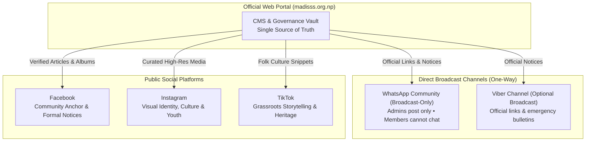
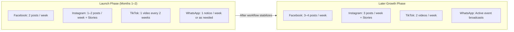
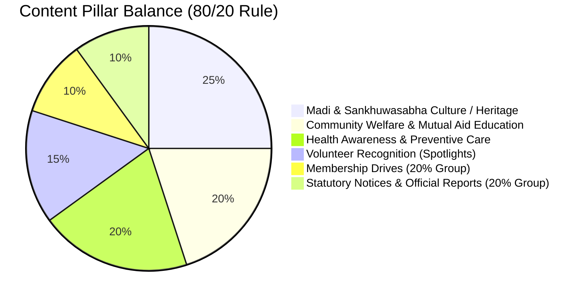
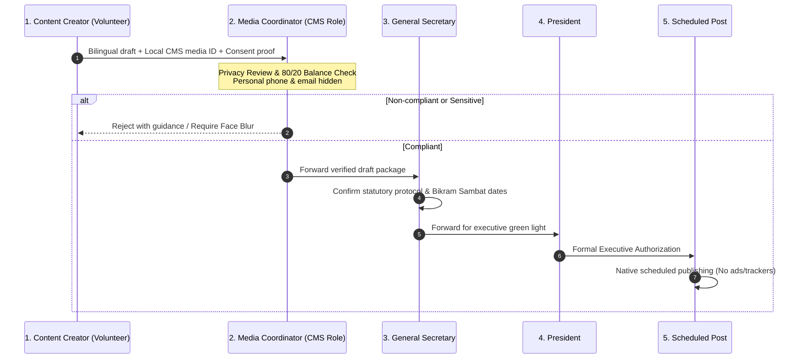

# Social Media & Digital Outreach Plan
## Madi (Sankhuwasabha) Sarokar Samaj, Kathmandu (मादी संखुवासभा सरोकार समाज, काठमाडौं)

> [!IMPORTANT]
> **Governance Notice & Execution Boundaries:**
> - This is an internal planning blueprint for a **nonprofit community welfare organization**, not a commercial enterprise.
> - **Zero Public Broadcasting / Scheduling:** No social media posts, announcements, or messages are to be published until explicitly sanctioned.
> - **Strict Privacy & Sensitive Media Embargo:** Absolute ban on public posting of condolence notices, patient identification, raw relief handover photos, and ward correspondence.
> - **Personal Data Protection:** The Media & Communications Coordinator’s personal phone number and personal email are strictly protected and never displayed publicly.
> - **Zero Ads & Zero Third-Party Trackers:** Meta Ads, Google Ads, GTM, GA4, and Meta Pixel remain strictly disconnected.

---

## 1. Platform Roles & Phased Architecture

| Platform / Channel | Channel Mode & Role | Formats & Content | Strategic Purpose |
| :--- | :--- | :--- | :--- |
| **Facebook** | **Public Community Hub** Members from Madi in Kathmandu, seniors, diaspora, and partner organizations. | • Formal announcements & notices • Full curated post-event photo albums • Facebook Events (AGM, Blood Donation) • Facebook Live (speeches, AGM opening) | Central public town hall for verified notices, formal minutes, event invitations, and long-form community updates. |
| **Instagram** | **Visual Culture & Youth Engagement** Youth, students, young professionals, and cultural enthusiasts. | • Reels (15–30s high-energy clips) • Carousels (3–7 slide educational stories) • Stories (live event updates, polls) • Landscape features (Chauki, Madi) | Celebrating Sankhuwasabha’s natural heritage, preserving folk arts, and spotlighting community service. |
| **TikTok** | **Grassroots Discovery & Heritage** Wider public and folk culture followers. | • Short cultural clips (Deusi-Bhailo, music) • 30–60s health awareness & seasonal tips • Behind-the-scenes community work | Spreading awareness about traditions and welfare initiatives through organic discovery with zero ad spend. |
| **WhatsApp Community** | **Broadcast-Only Direct Alert Channel** All registered members and community families. | • Admin-only text bulletins • Event reminder cards • Direct links to `madisss.org.np` | **Zero spam, zero chat chaos:** Admins post approved notices only; members cannot post. Member phone numbers remain protected. |
| **Viber Channel** *(Optional)* | **Broadcast-Only Secondary Channel** Community members preferring Viber. | • Official meeting notices • Health camp schedules • Website link shares | Optional mirror channel for members who do not use WhatsApp. |

---

## 2. Phased Posting Cadence: Launch vs. Growth

To protect volunteer capacity and guarantee 100% compliance with privacy reviews, outreach is divided into two distinct phases:

### Detailed Posting Cadence Comparison

| Platform | Launch Phase (Months 1–2) | Growth Phase (Later) | Optimal Local Time (NPT) | Focus & Format |
| :--- | :--- | :--- | :--- | :--- |
| **Facebook** | **2 posts / week** | **3–4 posts / week** | Tue & Sat: 07:30–08:30 or 19:30–21:00 | 1 Cultural/Heritage post + 1 Community Welfare/Notice |
| **Instagram** | **1–2 posts / week + Stories** | **3 posts / week + Stories** | Wed & Sat: 12:30–13:30 or 20:00–21:30 | 1 Scenic Reel + 1 Welfare Carousel + Event Stories |
| **TikTok** | **1 video every 2 weeks (Bi-weekly)** | **2 videos / week** | Alt. Fridays: 18:30–20:30 | 15–30s Folk song / Heritage snippet / Health tip |
| **WhatsApp Community** | **1 bulletin / week (or urgent notice)** | **1–2 bulletins / week** | Mornings: 08:00–09:00 | Broadcast-only: Event reminders & website links |
| **Viber Channel** | **Optional Mirror (As needed)** | **Mirrored with WhatsApp** | Same as WhatsApp | Official notices only |

---

## 3. Direct Broadcast Channel Architecture (WhatsApp & Viber)

### WhatsApp Community Plan (Broadcast-Only)
- **Role:** Direct, immediate delivery of formal notices to members' phones without the noise of interactive group chats.
- **Rules of Operation:**
  1. **Strict Broadcast-Only Mode:** Group settings configured to **"Only admins can send messages"**. General members cannot chat, debate, or forward unsolicited media.
  2. **Allowed Content Types:**
     - Official executive notices (AGM dates, DAO registration confirmation).
     - Health camp, blood donation, and cultural event venue and time cards.
     - Direct links to formal reports on `madisss.org.np`.
  3. **Prohibited Content Types:**
     - Political discussions, personal opinions, or commercial solicitations.
     - Raw bank account numbers, personal phone numbers, or unverified forward chains.
     - Condolence notices or unredacted patient/relief photos.
  4. **Privacy Protection:** Community Announcement channels protect participant privacy by hiding the full member phone directory from standard members.

### Viber Broadcast Channel Plan (Optional Alternative)
- **Role:** Supplementary broadcast channel for elders and community members whose primary messaging application is Viber.
- **Rules of Operation:** 100% mirrors the WhatsApp broadcast announcements. One-way publishing only.

---

## 4. Content Pillars & 80/20 Balance Architecture

The organization strictly enforces an **80/20 non-commercial balance**:
- **80% Value, Culture, Welfare, & Identity:** Inspiring, cultural, health-educational, and solidarity-building content.
- **20% Action, Membership, & Official Business:** Direct calls to apply for membership, program attendance notices, and statutory disclosures.

---

## 5. Media & Communications Coordinator CMS Workflow Role

### Coordinator Role Specifications

1. **Title & CMS Role Key:**
   - Devanagari: `सञ्चार तथा प्रचारप्रसार संयोजक`
   - English: `Media & Communications Coordinator`
   - CMS System Role: `COMMUNICATIONS_COORDINATOR`
2. **Responsibilities:**
   - Screen every visual asset against the prohibited sensitive media list.
   - Enforce the 80/20 content distribution ratio.
   - Verify Devanagari Unicode spelling, Bikram Sambat date accuracy, and clean English translations.
   - Verify that all media is served from approved local CMS paths (`/media/incoming/...`).
   - Forward compliant packages to the General Secretary.
3. **Strict Privacy Invariant:**
   - **Zero Public Disclosure:** The Coordinator’s personal phone number, personal email address, and home address are **never displayed publicly** on the website or on social channels.
   - All external inquiries are directed strictly to the official website contact page (`madisss.org.np/feedback`) or the central organizational email once activated.

---

## 6. Strict Privacy & Sensitive Media Embargo Rules

> [!CAUTION]
> **Zero Tolerance Embargo List:**
> 1. **Condolence (समवेदना):** Banned from public social feeds, reels, and hero displays.
> 2. **Patient Identification:** No identifiable faces, hospital bed tags, or diagnostic reports without explicit clinical consent.
> 3. **Relief Beneficiaries:** Never show vulnerable individuals or children receiving aid in a manner compromising dignity. Monetary amounts on vouchers must be masked.
> 4. **Ward Correspondence:** Government administrative recommendation letters must not be posted raw.
> 5. **Personal Contact Details:** Never post citizenship numbers, personal phone numbers, or bank account numbers of executives or citizens.

---

## 7. Sample First-Month Content Calendar (Launch Phase)

*Cadence: 2 Facebook posts / week • 1–2 Instagram posts / week + Stories • 1 TikTok video every two weeks (bi-weekly) • 1 WhatsApp Community broadcast / week.*

| Week & Day | Channel | Content Pillar | Nepali Caption (Devanagari) | English Caption | Required Media Asset | Privacy / Consent Gate | Status | Official Link |
| :---: | :---: | :--- | :--- | :--- | :--- | :---: | :---: | :---: |
| **W1 • Tue** | Facebook | Heritage & Identity (Photo Feature) | संखुवासभाको प्राकृतिक सौन्दर्य र ऐतिहासिक मादीको सेरोफेरो। हाम्रा पुर्खाको पसिना र गौरवमय परम्परालाई स्मरण गर्दै नयाँ पुस्तालाई आफ्नो माटोसँग जोड्ने हाम्रो साझा प्रयास। | Celebrating the timeless natural beauty and rich cultural heritage of Madi, Sankhuwasabha. Staying rooted in our origins while serving our community in Kathmandu. | `med-inc-002` (Chauki.jpg) | Landscape — Safe | Approved | `madisss.org.np` |
| **W1 • Thu** | WhatsApp | Official Broadcast | **आधिकारिक जानकारी:** मादी (संखुवासभा) सरोकार समाज, काठमाडौंको आधिकारिक वेबसाइट सञ्चालनमा आएको सहर्ष जानकारी गराउँदछौं। संस्थाका गतिविधि तथा विवरणका लागि madisss.org.np मा जोडिनुहोला। | **Official Notice:** Madi (Sankhuwasabha) Sarokar Samaj website is now operational. Visit madisss.org.np for updates. | Text only + Official link | Broadcast-Only; Admins only | Approved | `madisss.org.np` |
| **W1 • Sat** | FB + IG | Transparency & Notice (Graphic) | संस्थागत अद्यावधिक: मादी (संखुवासभा) सरोकार समाज जिल्ला प्रशासन कार्यालय, काठमाडौंमा विधिवत दर्ता (दर्ता नं. १६) भई सामाजिक सेवामा क्रियाशील छ। | Organizational Milestone: Madi (Sankhuwasabha) Sarokar Samaj is duly registered with District Administration Office, Kathmandu (Reg. No. 16). | Official Seal & Emblem Graphic (Redacted cert) | Statutory Public Record | Approved (Pres) | `madisss.org.np/reports` |
| **W2 • Tue** | Facebook | Community Welfare (Story Post) | काठमाडौंमा अध्ययन तथा पेशा व्यवसायमा रहनुभएका सम्पूर्ण मादीवासी दाजुभाइ तथा दिदीबहिनीहरूमा आपसी सद्भाव, एकता र भाइचाराको हार्दिक शुभकामना। | Fostering unity, mutual assistance, and solidarity among all residents from Madi currently living, working, or studying in Kathmandu. | `med-inc-005` (Madi.jpg) | Landscape — Safe | Approved | `madisss.org.np/about` |
| **W2 • Fri** | TikTok | Culture & Folk Life (Video #1) | मादीको माटो, लोक संस्कृति र देउसी–भैलोका मौलिक धुनहरू। हाम्रो परम्परा, हाम्रो पहिचान! | Traditional folk rhythms and cultural heritage of Madi. Preserving our indigenous art and unity. | `med-inc-013` (deusi nach video) | Performance consent verified | Approved (GenSec) | — |
| **W2 • Sat** | Instagram | Health Awareness (Carousel + Story) | मौसमी स्वास्थ्य सचेतना: जाडो मौसममा ज्येष्ठ नागरिक तथा बालबालिकाको स्याहार तथा सामान्य स्वास्थ्य परामर्श। | Seasonal Wellness Tips: Preventive care and health precautions for elders and children during seasonal changes. | Health Tip Graphic (No patient photos) | Medically verified | Approved | `madisss.org.np/activities` |
| **W3 • Tue** | Facebook | Volunteer Recognition (Single Slide) | निःस्वार्थ सेवा नै हाम्रो पहिचान। संस्थाका विभिन्न सामाजिक अभियानहरूमा खटिनुहुने स्वयंसेवक साथीहरूको योगदानको उच्च कदर गर्दछौं। | Honoring the dedication and spirit of our community volunteers whose selfless efforts drive our welfare initiatives forward. | Verified field volunteer photo | Written photo consent on file | Approved | `madisss.org.np/about` |
| **W3 • Thu** | WhatsApp | Event Reminder | **स्मरण पत्र:** आगामी निःशुल्क स्वास्थ्य परामर्श शिविरको प्रारम्भिक तयारी सुरु भएको छ। विस्तृत जानकारी चाँडै वेबसाइटमा प्रकाशित गरिनेछ। | **Reminder:** Preparations for the upcoming Community Health Consultation Camp are underway. Details soon on our portal. | Text card + link | Broadcast-Only; Admins only | Approved | `madisss.org.np/activities` |
| **W3 • Sat** | FB + IG | Cultural Heritage (Photo Feature) | संखुवासभाको मौलिक पहिचान र परम्परागत चाडपर्वहरू। पुर्ख्यौली ज्ञान र संस्कारलाई पुस्तान्तरण गर्ने हाम्रो अभियान। | Preserving our ancestral traditions and passing down cultural values to the next generation. | `med-inc-003` (Deusi taiyari.jpg) | Event photo — Safe | Approved | `madisss.org.np` |
| **W4 • Tue** | Facebook | Membership Drive (20% Action) | संस्थाको बृहत्तर सामाजिक अभियानमा हातेमालो गर्न सम्पूर्ण मादीवासी महानुभावहरूलाई अनलाइन सदस्यता आवेदनका लागि सादर आह्वान गर्दछौं। | Join hands in our community welfare mission. We cordially invite all residents from Madi to apply for membership via our official portal. | Membership Card Graphic | Safe Template | Approved | `madisss.org.np/membership` |
| **W4 • Fri** | TikTok | Heritage Snippet (Video #2) | मादीको सेरोफेरो — चौकि बजार र संखुवासभाका सुन्दर डाँडाकाँडाहरू। | Glimpses of Chauki Bazaar and the scenic highlands of Madi, Sankhuwasabha. | `med-inc-002` (Scenic video clip) | Landscape — Safe | Approved | `madisss.org.np` |
| **W4 • Sat** | Instagram | Monthly Recap (Carousel + Story) | यस महिनाका प्रमुख गतिविधि र सामुदायिक सन्देशहरूको संक्षिप्त समीक्षा। हातेमालो गर्नुहुने सम्पूर्णमा हार्दिक धन्यवाद! | A brief retrospective of our community welfare messages and cultural updates for the month. Thank you for your solidarity! | 4-Slide Recap Graphic | Compliant local media | Approved | `madisss.org.np` |

---

## 8. Practical Tooling for Volunteer Operations

1. **Meta Business Suite (Free):** Schedules Facebook and Instagram posts simultaneously without third-party paid subscriptions.
2. **TikTok Creator Web:** Native browser upload and scheduling for bi-weekly cultural clips.
3. **Official Broadcast Groups:** Admin-only announcement channels on WhatsApp (and Viber as secondary) with zero member chatting permitted.
4. **Moderation Standard:** Standard polite response to all public comments:  
   *“हार्दिक धन्यवाद। थप आधिकारिक जानकारी तथा सुझावका लागि कृपया हाम्रो वेबसाइट madisss.org.np/feedback मा सम्पर्क गर्नुहोला।”*
